<div dir="rtl">

# شبیه‌سازی سناریوهای تقلب در نظام بانکی ایران

## گزارش فنی

**تهیه‌کننده:** Mohammad Motiebirjandi  
**تاریخ:** آبان ۱۴۰۵  
**پایگاه داده:** Neo4j 5.26.2

---

## ۱. مقدمه و هدف

در این پروژه ۹ سناریوی تقلب و پولشویی روی داده‌های مصنوعی شبیه‌سازی شده است. داده‌ها کاملاً ساختگی‌اند ولی قواعد نظام بانکی ایران را رعایت می‌کنند. سؤال اصلی این بود که تحلیل گرافی تا کجا می‌تواند الگوهایی را پیدا کند که عمداً لای فعالیت عادی پنهان شده‌اند.

داده‌ها شامل ۱۸۰ حساب متعلق به ۱۵۰ مشتری در ۱۰ بانک و ۱٬۶۶۵ تراکنش است. از این تراکنش‌ها ۲۲۸ مورد تقلبِ کاشته‌شده است و بقیه فعالیت عادی (نویز). داده‌ها در پایگاه داده‌ی گرافی Neo4j بارگذاری شده‌اند و یک API برای تحلیل مسیر روی آن ساخته شده است.

### ۱.۱ ابزارها

| ابزار | کاربرد |
|---|---|
| Python 3.10+ | تولید داده‌ی مصنوعی، اعتبارسنجی و تحلیل |
| Neo4j 5.26.2 | پایگاه داده‌ی گرافی |
| Docker | اجرای Neo4j و API |
| Cypher | زبان پرس‌وجوی گراف |
| FastAPI | سرویس تحلیل مسیر |
| NetworkX / Matplotlib | رسم نمودارها |

---

## ۲. روش تولید داده

داده‌ها با اسکریپت تولید می‌شوند و چون seed ثابت است، هر اجرا دقیقاً همان داده را می‌سازد. در تولید داده دو قید رعایت شده: داده باید به داده‌ی واقعی بانکی نزدیک باشد و الگوی تقلب باید لای نویز پنهان بماند.

### ۲.۱ تولید حساب‌ها

- شماره‌ی شبا: ۲۶ کاراکتر با رقم کنترل mod-97 و شناسه‌ی واقعی بانک‌ها (مثلاً 017 برای ملی، 012 برای ملت و 057 برای پاسارگاد)
- شماره‌ی ملی اشخاص حقیقی: ۱۰ رقم با رقم کنترل معتبر
- شناسه‌ی ملی اشخاص حقوقی: ۱۱ رقم با رقم کنترل معتبر
- شناسه‌ی شهاب: ۱۶ رقم برای هر مشتری
- هر بانک شعبه‌های خودش را دارد و هر حساب در یکی از شعبه‌های همان بانک باز می‌شود
- فایل حساب‌ها در قالب ۳۰ ستونی FATF است؛ هر سطر یک رابطه‌ی مشتری و حساب است (مالک، شریک یا صاحب امضا)

### ۲.۲ تولید تراکنش‌ها

- انواع تراکنش: واریز نقدی، برداشت نقدی، انتقال داخلی (هم‌بانک)، پایا، و ساتنا برای انتقال بین‌بانکی ۱۵۰ میلیون ریال به بالا
- تراکنش نقدی طرف مقابل ندارد: واریز نقدی فرستنده ندارد و برداشت نقدی گیرنده
- تاریخ‌ها با تقویم شمسی واقعی ساخته می‌شوند (طول درست ماه‌ها و سال کبیسه)
- تراکنش شعبه، پایا و ساتنا در روز جمعه انجام نمی‌شود
- کانال‌ها: اینترنت‌بانک، موبایل‌بانک، شعبه و خودپرداز

### ۲.۳ نویز و پنهان‌سازی

در هر سناریو، فعالیت عادی در کل بازه‌ی زمانی سناریو پخش شده است: خرید از فروشگاه، انتقال شخصی با مبالغ رُند و اغلب بدون شرح، حقوق ماهانه‌ی ۲۲ تا ۴۹٫۵ میلیون ریال (درست زیر سقف ۵۰ میلیونی)، واریز و برداشت نقدی، فاکتورهای B2B که میانه‌شان حدود ۳۲۵ میلیون است و بعضی از ۱ میلیارد هم بیشترند، و گاهی انتقال شخصی ۱۵۰ تا ۶۰۰ میلیونی.

تراکنش‌های تقلب شرح معمولی یا خالی دارند و مبالغشان با تراکنش‌های قانونی هم‌پوشانی دارد. حساب‌های درگیر در تقلب هم فعالیت عادی دارند؛ تنها استثنا قربانیان راکد سناریوی ۰۷ هستند.

### ۲.۴ برچسب‌های مرجع

تراکنش‌های کاشته‌شده‌ی هر سناریو همراه با نقششان در فایل `ground_truth.csv` ثبت شده‌اند. این برچسب‌ها در فایل `transactions.csv` نیامده‌اند و در Neo4j هم بارگذاری نمی‌شوند، پس کوئری‌های تشخیص به آن‌ها دسترسی ندارند. کاربرد این فایل فقط سنجیدن نتایج است.

---

## ۳. اعتبارسنجی داده‌ها

| شاخص | مقدار | وضعیت |
|---|---|---|
| حساب‌ها | ۱۸۰ | PASS |
| مشتریان | ۱۵۰ | PASS |
| تراکنش‌ها | ۱٬۶۶۵ | PASS |
| تراکنش نقدی (یک‌طرفه، طبق انتظار) | ۲۶۷ | PASS |
| تراکنش بدون فرستنده و گیرنده | ۰ | PASS |
| ارجاع به شبای ناشناخته | ۰ | PASS |
| شناسه‌ی تراکنش تکراری | ۰ | PASS |
| مبلغ صفر یا منفی | ۰ | PASS |
| انتقال به خود | ۰ | PASS |

رقم کنترل همه‌ی شباها، شماره‌های ملی و شناسه‌های ملی معتبر است و تاریخ نامعتبری در داده نیست.

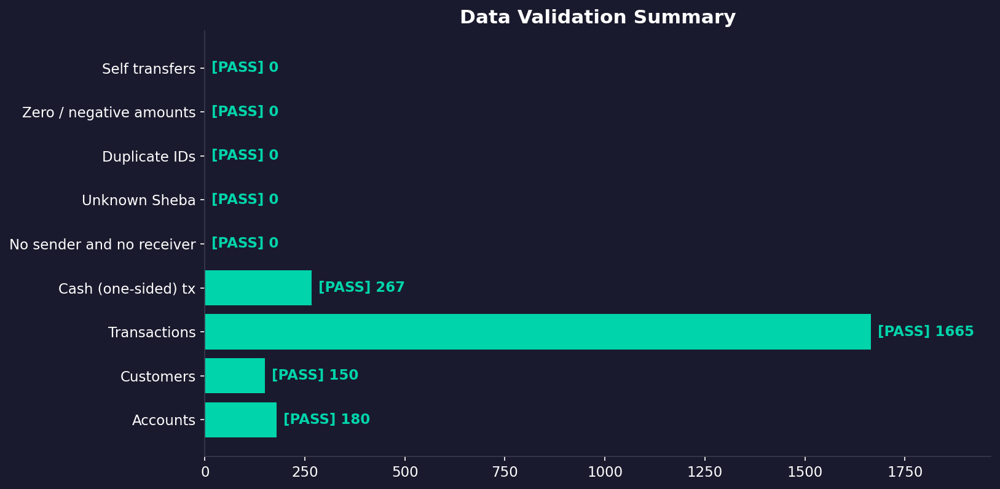

---

## ۴. مدل گرافی Neo4j

### ۴.۱ گره‌ها (Nodes)

| گره | تعداد |
|---|---|
| Bank | ۱۰ |
| Customer | ۱۵۰ |
| Customer:Person | ۱۲۰ |
| Customer:Person:ForeignNational | ۹ |
| Customer:Company | ۳۰ |
| Account | ۱۸۰ |
| Transaction | ۱٬۶۶۵ |

### ۴.۲ روابط (Relationships)

| رابطه | جهت | تعداد |
|---|---|---|
| OWNS_ACCOUNT | Customer → Account | ۲۱۷ |
| BELONGS_TO_BANK | Account → Bank | ۱۸۰ |
| SENT | Account → Transaction | ۱٬۵۲۶ |
| RECEIVED | Transaction → Account | ۱٬۵۳۷ |

واریز نقدی فقط رابطه‌ی RECEIVED دارد و برداشت نقدی فقط رابطه‌ی SENT.

### ۴.۳ نمای کلی گراف

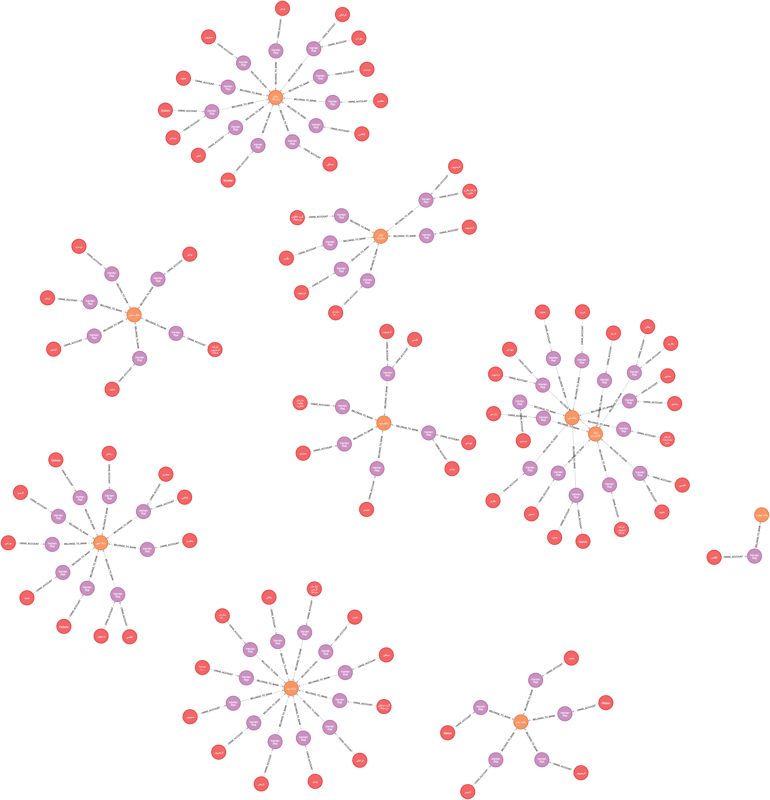

---

## ۵. خلاصه‌ی سناریوها

| # | سناریو | تراکنش | کاشته‌شده | بازه | الگو |
|---|---|---|---|---|---|
| ۰۱ | لایه‌گذاری ساده | ۱۳۵ | ۱۵ | ۱ فروردین ۱۴۰۳ تا ۴ اردیبهشت ۱۴۰۳ | نقد → A→B→C→D → نقد (۳ دور) |
| ۰۲ | خرد کردن تراکنش | ۱۸۱ | ۳۱ | ۱ فروردین ۱۴۰۳ تا ۴ اردیبهشت ۱۴۰۳ | ۱۵ واریز نقدی زیر سقف → حساب تجمیع‌کننده |
| ۰۳ | شبکه‌ی شرکت‌های کاغذی | ۱۳۲ | ۱۲ | ۱ فروردین ۱۴۰۳ تا ۱۵ اردیبهشت ۱۴۰۳ | A→B→C→A (۴ دور) |
| ۰۴ | تأمین مالی تروریسم | ۳۵۴ | ۱۰۴ | ۱ فروردین ۱۴۰۳ تا ۶ خرداد ۱۴۰۳ | ۵۰ اهداکننده → خیریه → NGO → تبعه‌ی خارجی |
| ۰۵ | تصاحب حساب | ۱۸۱ | ۴ | ۱ فروردین ۱۴۰۳ تا ۳۱ شهریور ۱۴۰۳ | ۶ ماه رفتار عادی، بعد تخلیه‌ی شبانه |
| ۰۶ | پولشویی مبتنی بر تجارت | ۱۶۰ | ۱۰ | ۱ فروردین ۱۴۰۳ تا ۲۸ خرداد ۱۴۰۳ | واردکننده → کارگزار (۱۵٪−) → تبعه‌ی خارجی (۵ دور) |
| ۰۷ | تقلب کارمند بانک | ۱۳۲ | ۱۲ | ۱ فروردین ۱۴۰۳ تا ۴ اردیبهشت ۱۴۰۳ | حساب‌های راکد یک شعبه → حساب‌های واسط → نقد |
| ۰۸ | پرداخت‌های دایره‌ای | ۲۲۴ | ۲۴ | ۱ فروردین ۱۴۰۳ تا ۲۴ اردیبهشت ۱۴۰۳ | حلقه‌ی ۱۸ حسابی تا مبدا + ۳ مسیر فرعی |
| ۰۹ | پخش و تجمیع | ۱۶۶ | ۱۶ | ۱ فروردین ۱۴۰۳ تا ۳۰ فروردین ۱۴۰۳ | یک مبدا → ۷ واسط → یک جمع‌کننده |

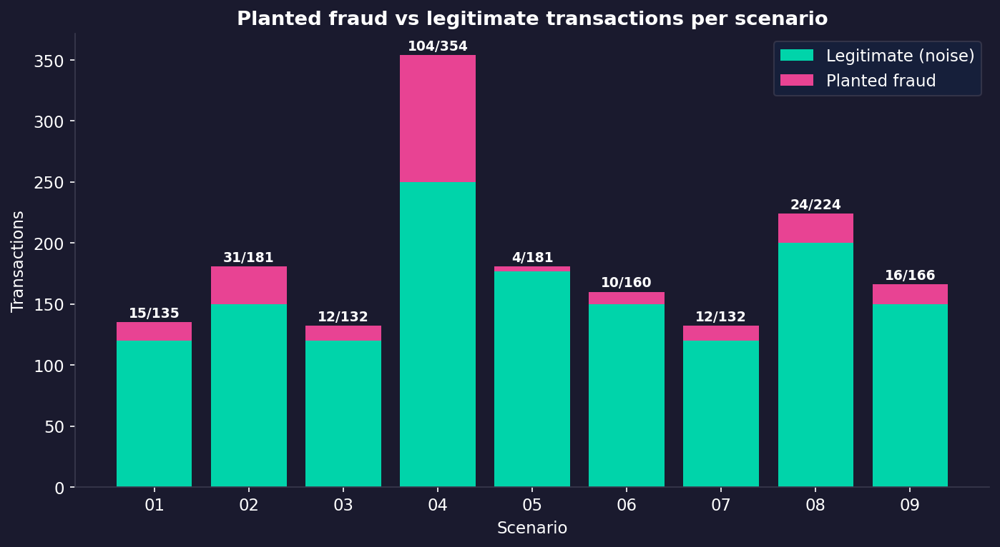

---

## ۶. سناریوی ۰۱: لایه‌گذاری ساده (Simple Layering)

### ۶.۱ شرح سناریو

در هر دور، مبلغی کمی کمتر از سقف گزارش‌دهی به‌صورت نقدی به یک حساب تازه‌افتتاح‌شده واریز می‌شود. پول ظرف حدود ۴ روز کاری از سه حساب حقیقی دیگر می‌گذرد، در هر گام ۵۰۰ هزار ریال از آن کم می‌شود و حساب آخر آن را نقد برداشت می‌کند. سه دور با مبالغ ۴۵، ۴۸٫۵ و ۴۲ میلیون ریال اجرا شده است.

**آمار:**

- الگو: نقد → A→B→C→D → نقد (۳ دور)
- تعداد تراکنش: ۱۳۵
- تراکنش کاشته‌شده: ۱۵
- تراکنش عادی: ۱۲۰
- حجم تراکنش‌های کاشته‌شده: ۶۵۴ میلیون ریال
- بازه: ۱ فروردین ۱۴۰۳ تا ۴ اردیبهشت ۱۴۰۳
- نقش‌ها: placement (۳)، layering (۹)، integration (۳)

### ۶.۲ چطور پنهان شده

- حقوق‌ها و واریزهای نقدی قانونی هم تا حدود ۴۹٫۵ میلیون ریال‌اند
- هر چهار حساب زنجیره تراکنش عادی هم دارند
- شرح تراکنش‌ها خالی یا معمولی است

### ۶.۳ نشانه‌های تقلب

- واریز نقدی زیر سقف که همان روز منتقل می‌شود
- عبور سریع از چند حساب با کم شدن تدریجی مبلغ
- حساب اول تازه افتتاح شده است
- برداشت نقدی در انتهای زنجیره

### ۶.۴ نمودارها

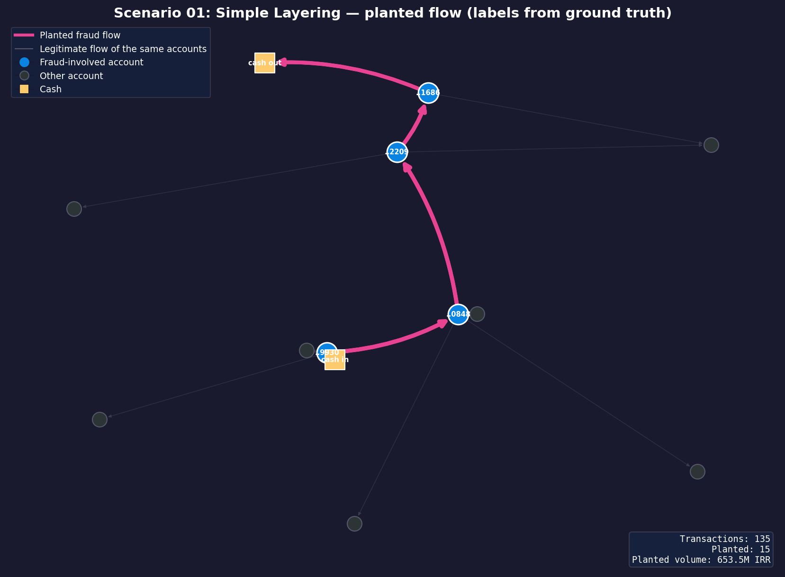

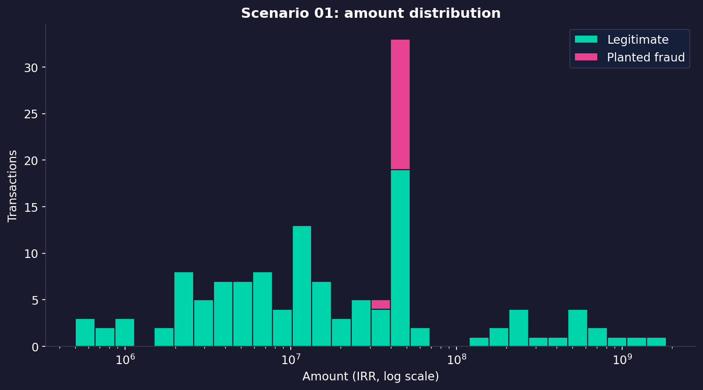

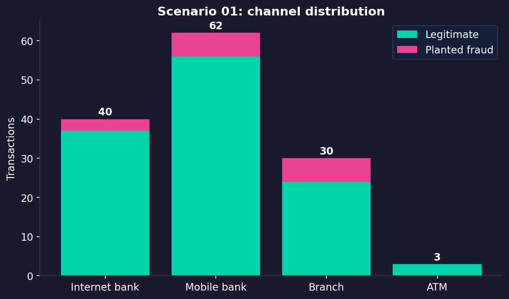

### ۶.۵ کوئری تشخیص

```cypher
MATCH p = (d:Transaction {scenario:'scenario_01', type:'واریز نقدی'})-[:RECEIVED]->(a:Account)
          -[:SENT]->(t1:Transaction {scenario:'scenario_01'})-[:RECEIVED]->(b:Account)
          -[:SENT]->(t2:Transaction {scenario:'scenario_01'})-[:RECEIVED]->(c:Account)
          -[:SENT]->(t3:Transaction {scenario:'scenario_01'})-[:RECEIVED]->(e:Account)
WHERE d.date <= t1.date < t2.date < t3.date
  AND 0.95 * d.amount  <= t1.amount <= d.amount
  AND 0.95 * t1.amount <= t2.amount <= t1.amount
  AND 0.95 * t2.amount <= t3.amount <= t2.amount
RETURN p
```

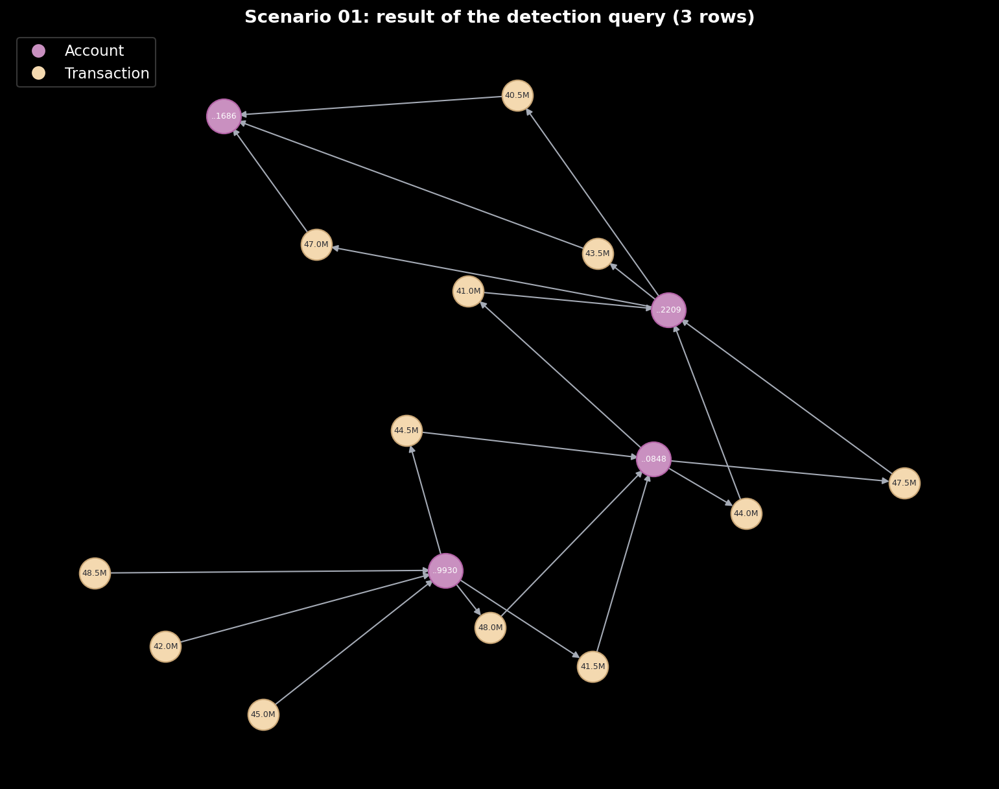

**نتیجه:** کوئری ۱۲ تراکنش برگرداند: ۱۲ مورد کاشته‌شده و ۰ مثبت کاذب. از ۱۵ تراکنش کاشته‌شده، ۱۲ مورد پیدا شد (۸۰٪).

کوئری برداشت نقدی آخر زنجیره (نقش integration) را برنمی‌گرداند. این برداشت با دنبال کردن حساب آخر پیدا می‌شود.

---

## ۷. سناریوی ۰۲: خرد کردن تراکنش (Structuring / Smurfing)

### ۷.۱ شرح سناریو

۹ حساب واسط در ۸ روز ۱۵ واریز نقدی بین ۴۳ تا ۴۹٫۵ میلیون ریال می‌گیرند، یعنی همه زیر سقف ۵۰ میلیونی. هر واریز همان روز به یک حساب تجمیع‌کننده می‌رود و این حساب روز دوازدهم حدود ۹۶٪ کل مبلغ را یکجا منتقل می‌کند.

**آمار:**

- الگو: ۱۵ واریز نقدی زیر سقف → حساب تجمیع‌کننده
- تعداد تراکنش: ۱۸۱
- تراکنش کاشته‌شده: ۳۱
- تراکنش عادی: ۱۵۰
- حجم تراکنش‌های کاشته‌شده: ۲٬۰۸۱ میلیون ریال
- بازه: ۱ فروردین ۱۴۰۳ تا ۴ اردیبهشت ۱۴۰۳
- نقش‌ها: structured_deposit (۱۵)، funnel_transfer (۱۵)، consolidation (۱)

### ۷.۲ چطور پنهان شده

- مبالغ با هم برابر نیستند
- حقوق‌ها و واریزهای نقدی قانونی هم در بازه‌ی ۴۰ تا ۵۰ میلیون‌اند
- حساب‌های واسط فعالیت عادی هم دارند

### ۷.۳ نشانه‌های تقلب

- واریز نقدی و انتقال همان مبلغ در یک روز
- چند حساب که همه به یک حساب پول می‌فرستند
- انتقال یکجای کل مبلغ چند روز بعد

### ۷.۴ نمودارها

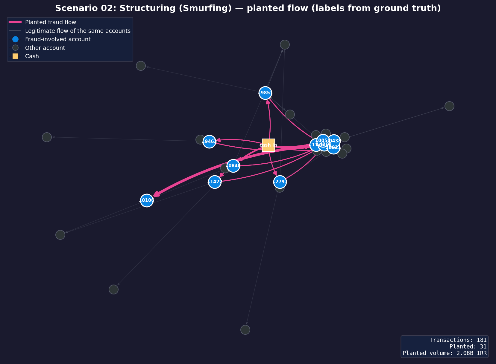

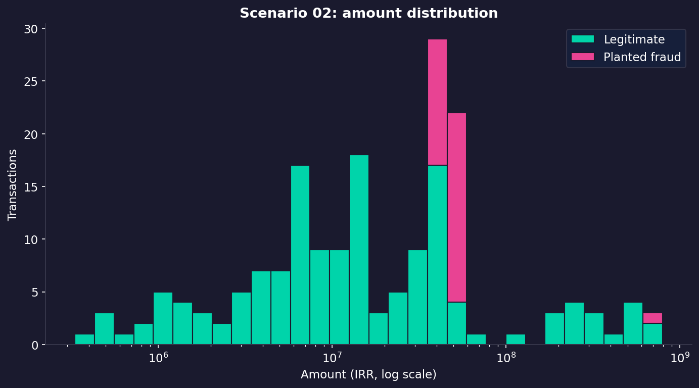

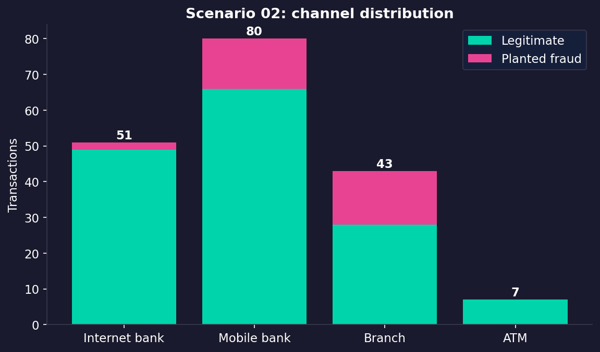

### ۷.۵ کوئری تشخیص

```cypher
MATCH p = (d:Transaction {scenario:'scenario_02', type:'واریز نقدی'})-[:RECEIVED]->(s:Account)
          -[:SENT]->(t:Transaction {scenario:'scenario_02'})-[:RECEIVED]->(agg:Account)
WHERE 40000000 <= d.amount < 50000000
  AND t.date = d.date AND 0.95 * d.amount <= t.amount <= d.amount
WITH agg, collect(p) AS paths, count(DISTINCT s) AS smurfs
WHERE smurfs >= 3
UNWIND paths AS p
RETURN p
```

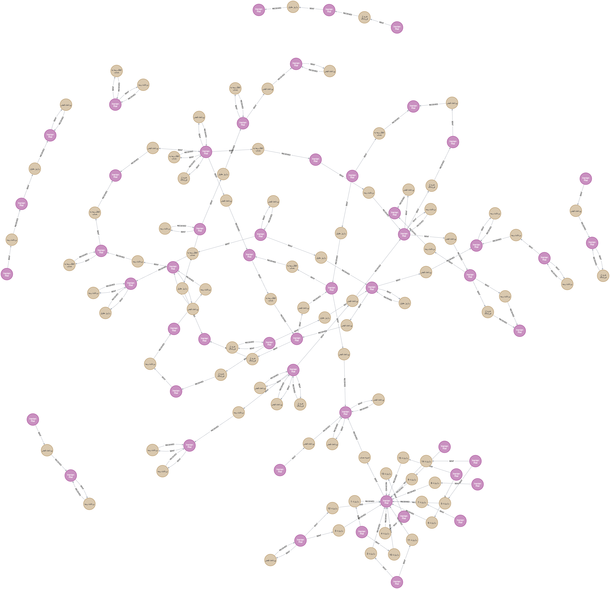

**نتیجه:** کوئری ۳۰ تراکنش برگرداند: ۳۰ مورد کاشته‌شده و ۰ مثبت کاذب. از ۳۱ تراکنش کاشته‌شده، ۳۰ مورد پیدا شد (۹۷٪).

انتقال یکجای آخر (consolidation) گام بعدی حساب تجمیع‌کننده است و در خروجی کوئری نیست.

---

## ۸. سناریوی ۰۳: شبکه‌ی شرکت‌های کاغذی (Shell Company Network)

### ۸.۱ شرح سناریو

سه حساب حقوقی متعلق به سه مشتری متفاوت در حدود ۶ هفته چهار بار پول را بین خود دور می‌دهند. هر دور با ۴۲۰ تا ۵۶۰ میلیون ریال شروع می‌شود و در هر گام ۳ تا ۷ درصد از آن کم می‌شود. شرح تراکنش‌ها شماره‌ی فاکتورهای پشت‌سرهم است، با خدماتی مثل مشاوره، مدیریت و بازرگانی.

**آمار:**

- الگو: A→B→C→A (۴ دور)
- تعداد تراکنش: ۱۳۲
- تراکنش کاشته‌شده: ۱۲
- تراکنش عادی: ۱۲۰
- حجم تراکنش‌های کاشته‌شده: ۵٬۲۵۰ میلیون ریال
- بازه: ۱ فروردین ۱۴۰۳ تا ۱۵ اردیبهشت ۱۴۰۳
- نقش‌ها: round_trip (۱۲)

### ۸.۲ چطور پنهان شده

- فاکتورهای B2B قانونی هم همین شکل شرح را دارند و مبالغشان مشابه است (میانه حدود ۳۲۵ میلیون و برخی بالای ۱ میلیارد)
- در نویز هم چرخه‌های کوچک طبیعی هست، پس یک کوئری ساده‌ی چرخه مثبت کاذب می‌دهد

### ۸.۳ نشانه‌های تقلب

- چرخه‌ی بسته‌ی سه‌تایی که بین همان شرکت‌ها تکرار می‌شود
- کم شدن مبلغ در هر گام
- شرح‌های کلی و مبهم

### ۸.۴ نمودارها

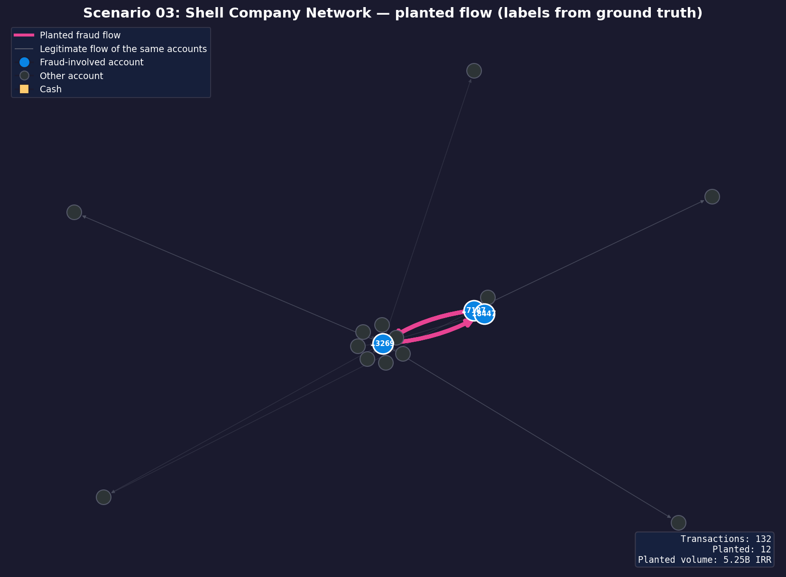

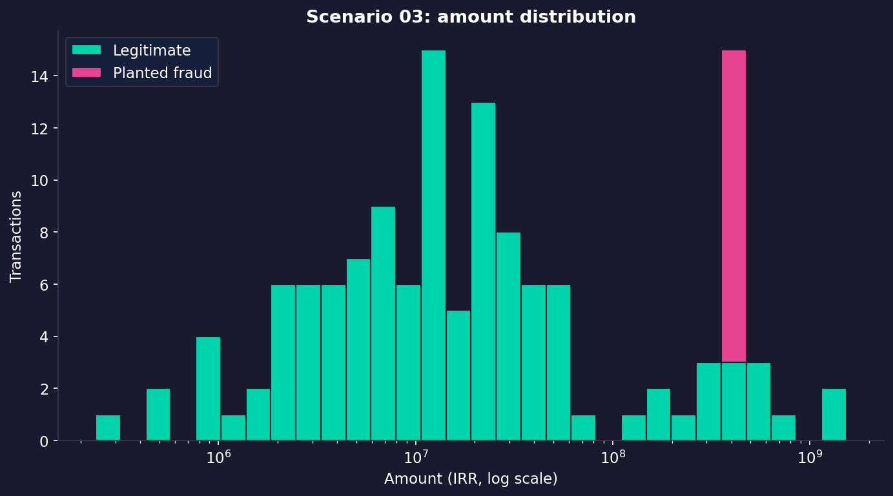

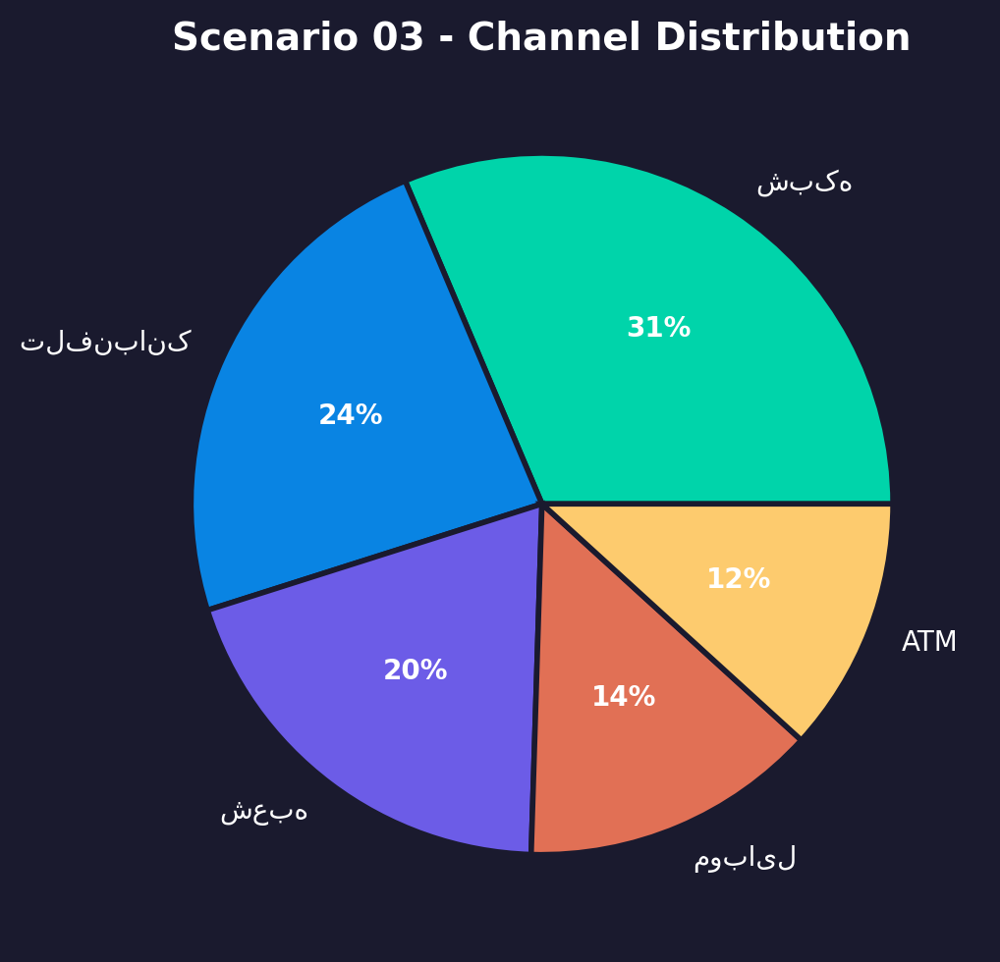

### ۸.۵ کوئری تشخیص

```cypher
MATCH p = (a:Account)-[:SENT]->(t1:Transaction {scenario:'scenario_03'})-[:RECEIVED]->(b:Account)
          -[:SENT]->(t2:Transaction {scenario:'scenario_03'})-[:RECEIVED]->(c:Account)
          -[:SENT]->(t3:Transaction {scenario:'scenario_03'})-[:RECEIVED]->(a)
WHERE a <> b AND b <> c AND a <> c
  AND t1.date < t2.date < t3.date
  AND 0.9 * t1.amount <= t2.amount <= t1.amount
  AND 0.9 * t2.amount <= t3.amount <= t2.amount
RETURN p
```

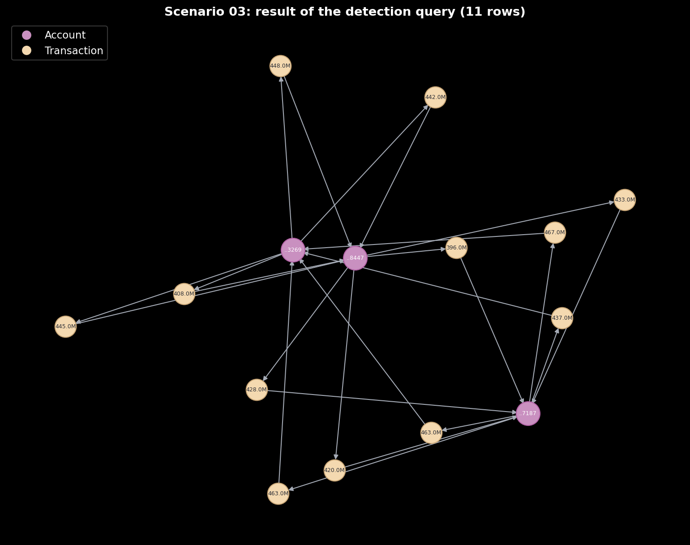

**نتیجه:** کوئری ۱۲ تراکنش برگرداند: ۱۲ مورد کاشته‌شده و ۰ مثبت کاذب. از ۱۲ تراکنش کاشته‌شده، ۱۲ مورد پیدا شد (۱۰۰٪).

---

## ۹. سناریوی ۰۴: تأمین مالی تروریسم (Terrorist Financing)

### ۹.۱ شرح سناریو

۵۰ اهداکننده‌ی غیرحقوقی، که چند تبعه‌ی خارجی هم بینشان هست، در ۶۰ روز هر کدام ۱ تا ۳ بار ۱ تا ۵ میلیون ریال به حساب یک مؤسسه‌ی خیریه واریز می‌کنند. خیریه در دو نوبت حدود ۹۵٪ پول جمع‌شده‌ی هر ماه را به یک NGO می‌دهد و NGO دو روز بعد حدود ۹۰٪ آن را به حساب یک تبعه‌ی خارجی می‌فرستد.

**آمار:**

- الگو: ۵۰ اهداکننده → خیریه → NGO → تبعه‌ی خارجی
- تعداد تراکنش: ۳۵۴
- تراکنش کاشته‌شده: ۱۰۴
- تراکنش عادی: ۲۵۰
- حجم تراکنش‌های کاشته‌شده: ۷۳۲ میلیون ریال
- بازه: ۱ فروردین ۱۴۰۳ تا ۶ خرداد ۱۴۰۳
- نقش‌ها: donation (۱۰۰)، aggregation (۲)، foreign_transfer (۲)

### ۹.۲ چطور پنهان شده

- فروشگاه‌های قانونی هم از افراد زیادی پرداخت کوچک می‌گیرند
- شرح کمک‌ها معمولی است: «کمک خیریه»، «نذر» یا خالی

### ۹.۳ نشانه‌های تقلب

- تعداد زیادی واریز کوچک به یک حساب که زود خارج می‌شود
- خیریه پول را نگه نمی‌دارد
- گیرنده‌ی نهایی تبعه‌ی خارجی است

### ۹.۴ نمودارها

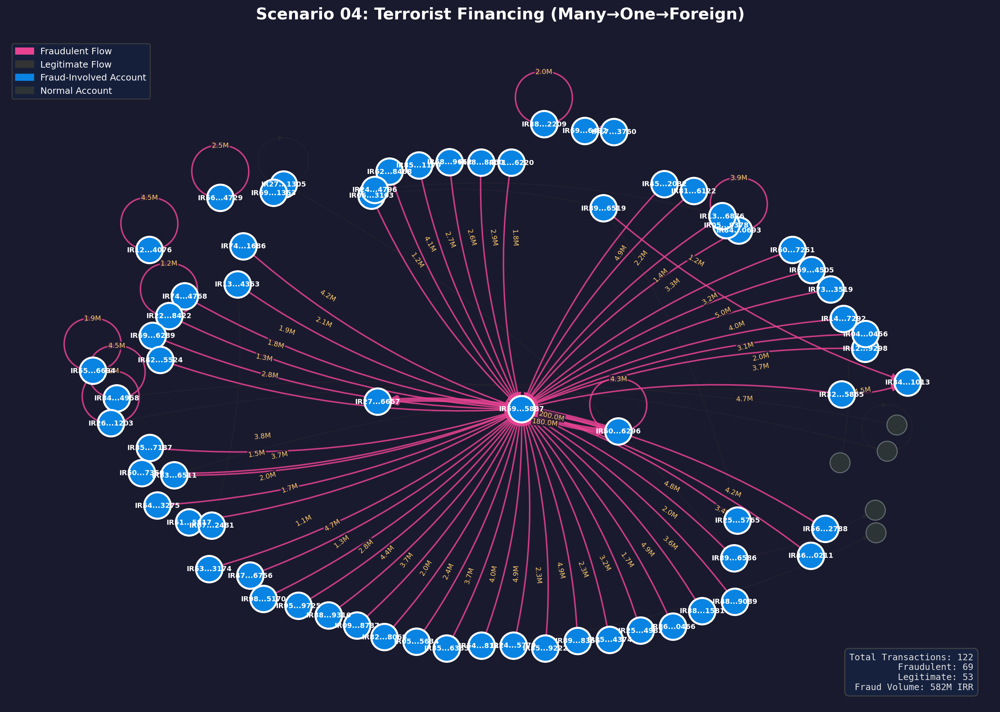

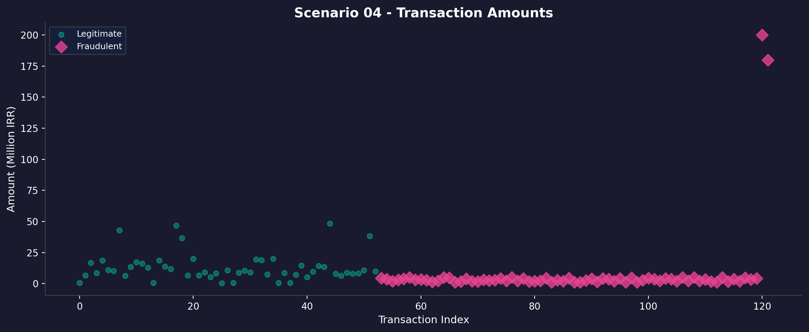

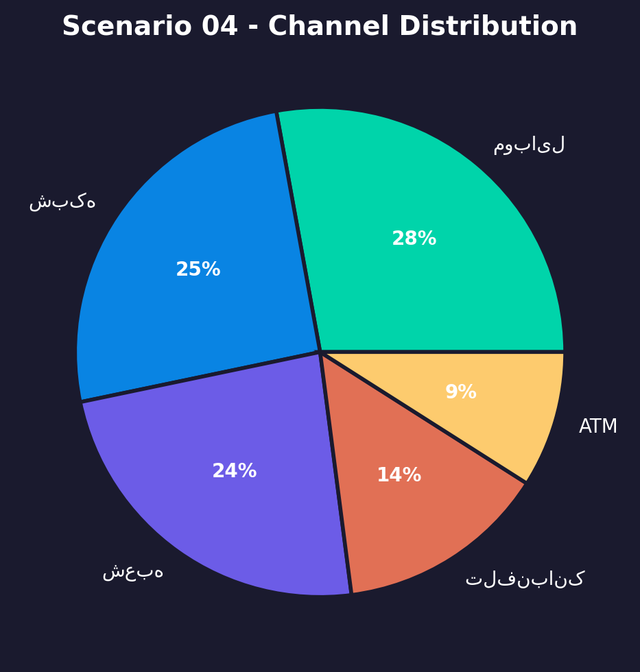

### ۹.۵ کوئری تشخیص

```cypher
MATCH (donor:Account)-[:SENT]->(d:Transaction {scenario:'scenario_04'})-[:RECEIVED]->(hub:Account)
WHERE d.amount <= 5000000
WITH hub, count(DISTINCT donor) AS donors, sum(d.amount) AS collected
WHERE donors >= 20
MATCH p = (hub)-[:SENT]->(t1:Transaction {scenario:'scenario_04'})-[:RECEIVED]->(mid:Account)
          -[:SENT]->(t2:Transaction {scenario:'scenario_04'})-[:RECEIVED]->(dst:Account)
WHERE (dst)<-[:OWNS_ACCOUNT]-(:ForeignNational)
  AND t1.date <= t2.date
  AND t1.amount >= 0.2 * collected AND 0.8 * t1.amount <= t2.amount <= t1.amount
MATCH q = (:Account)-[:SENT]->(d2:Transaction {scenario:'scenario_04'})-[:RECEIVED]->(hub)
WHERE d2.amount <= 5000000
RETURN p, collect(q) AS donations
```

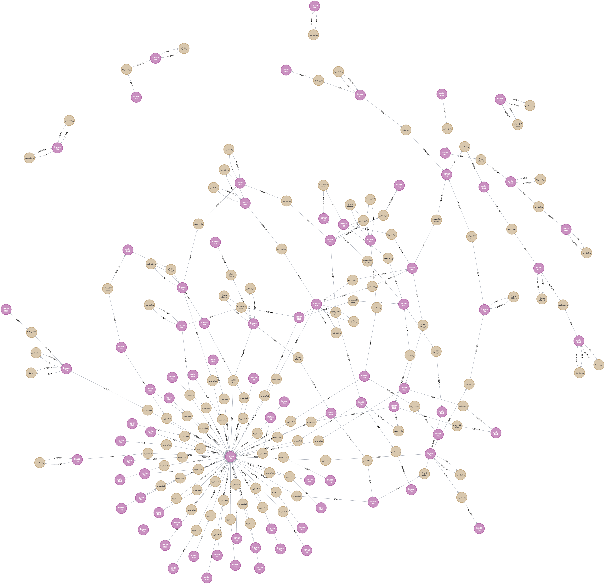

**نتیجه:** کوئری ۱۰۴ تراکنش برگرداند: ۱۰۴ مورد کاشته‌شده و ۰ مثبت کاذب. از ۱۰۴ تراکنش کاشته‌شده، ۱۰۴ مورد پیدا شد (۱۰۰٪).

---

## ۱۰. سناریوی ۰۵: تصاحب حساب (Account Takeover)

### ۱۰.۱ شرح سناریو

حساب یک بازنشسته که پیش از ۱۳۹۵ افتتاح شده، شش ماه رفتار ثابتی دارد: ماهی ۲۵ میلیون ریال حقوق بازنشستگی، چند خرید کوچک و یک برداشت از خودپرداز. بعد، بین ساعت ۰ تا ۵ بامداد و با موبایل‌بانک، ۵۰۰ میلیون ریال به یک حساب تازه‌افتتاح‌شده می‌رود و در ۴ روز بعد ۲۰۰، ۱۸۰ و ۱۵۰ میلیون ریال به حساب دیگری.

**آمار:**

- الگو: ۶ ماه رفتار عادی، بعد تخلیه‌ی شبانه
- تعداد تراکنش: ۱۸۱
- تراکنش کاشته‌شده: ۴
- تراکنش عادی: ۱۷۷
- حجم تراکنش‌های کاشته‌شده: ۱٬۰۳۰ میلیون ریال
- بازه: ۱ فروردین ۱۴۰۳ تا ۳۱ شهریور ۱۴۰۳
- نقش‌ها: takeover_transfer (۱)، drain (۳)

### ۱۰.۲ چطور پنهان شده

- انتقال‌های شخصی قانونی ۱۵۰ تا ۶۰۰ میلیونی (خرید خودرو، ودیعه‌ی مسکن) در داده وجود دارد
- رفتار عادی قربانی برچسب ندارد

### ۱۰.۳ نشانه‌های تقلب

- مبلغ حدود ۲۰ برابر رفتار معمول حساب
- ساعت غیرعادی بامداد
- گیرنده‌های جدید

### ۱۰.۴ نمودارها

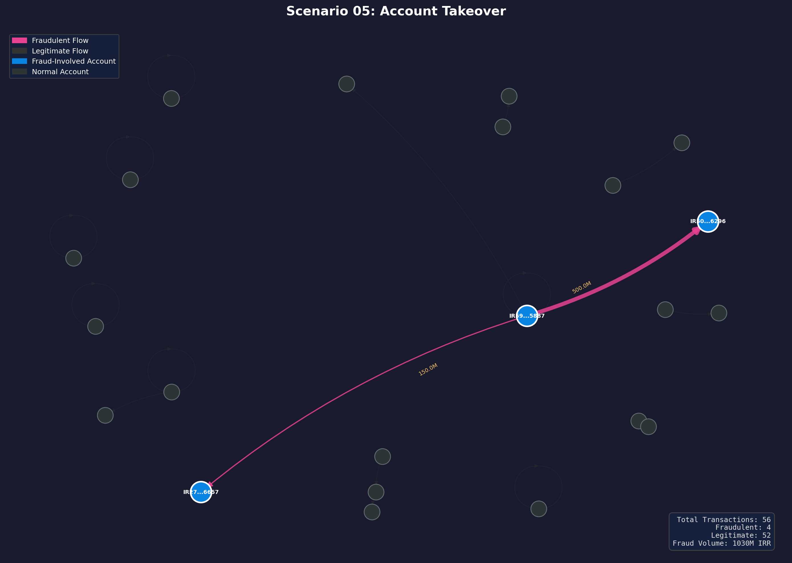

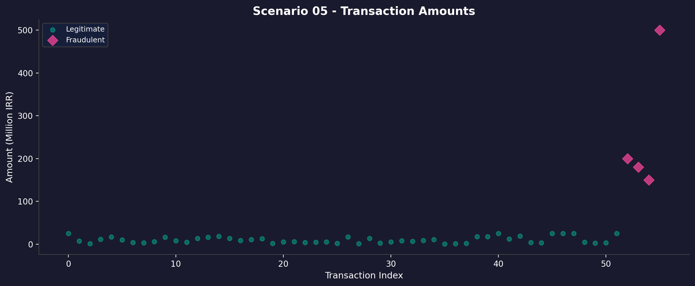

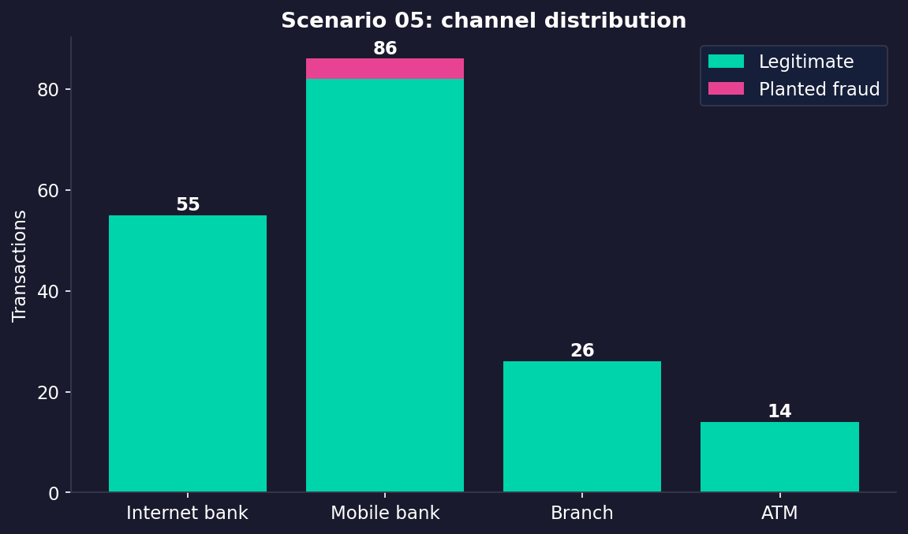

### ۱۰.۵ کوئری تشخیص

```cypher
MATCH (a:Account)-[:SENT]->(t:Transaction {scenario:'scenario_05'})
WITH a, percentileCont(t.amount, 0.5) AS typical
MATCH p = (a)-[:SENT]->(x:Transaction {scenario:'scenario_05'})-[:RECEIVED]->(:Account)
WHERE x.amount >= 20 * typical AND x.time < '060000'
RETURN p
```

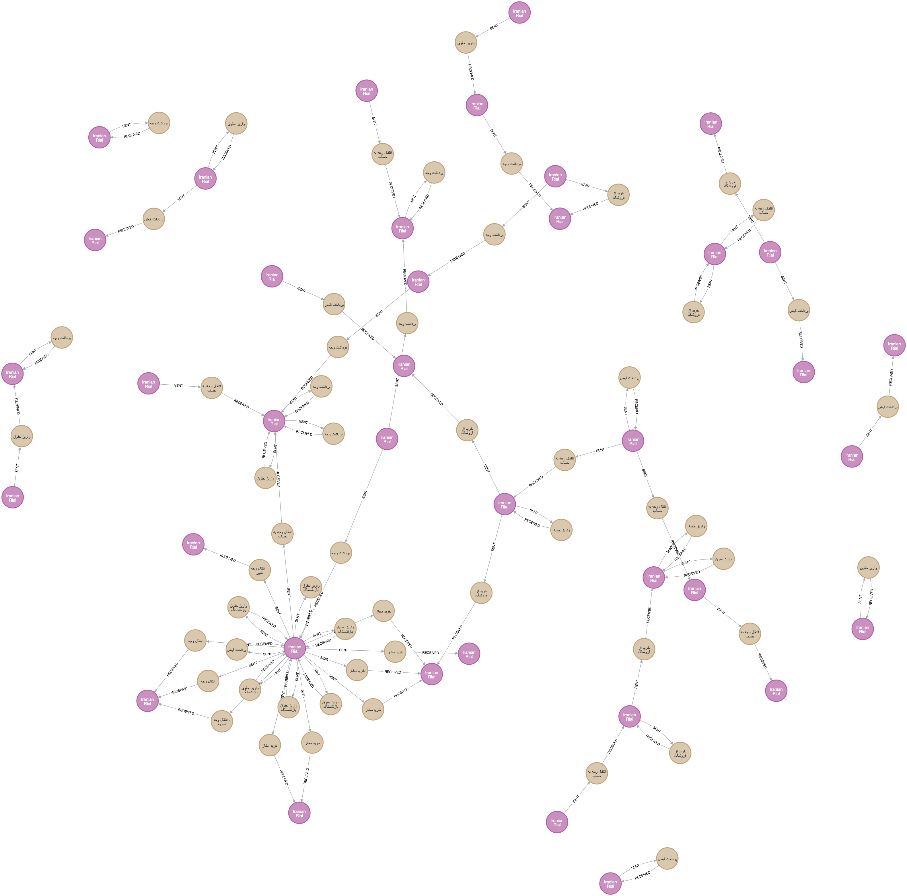

**نتیجه:** کوئری ۴ تراکنش برگرداند: ۴ مورد کاشته‌شده و ۰ مثبت کاذب. از ۴ تراکنش کاشته‌شده، ۴ مورد پیدا شد (۱۰۰٪).

---

## ۱۱. سناریوی ۰۶: پولشویی مبتنی بر تجارت (Trade-Based ML)

### ۱۱.۱ شرح سناریو

یک شرکت واردکننده تقریباً هر ۲۰ روز ۰٫۹ تا ۱٫۲ میلیارد ریال بابت پروفرما به یک کارگزار می‌پردازد. کارگزار ۱ تا ۳ روز بعد حدود ۸۵٪ آن را به حساب یک تبعه‌ی خارجی می‌فرستد. بیش‌اظهاری فاکتور در داده‌ی پرداخت دیده نمی‌شود و برای دیدنش اظهارنامه‌ی گمرکی لازم است. آنچه در داده هست، عبور تکراری پول است و سهم ثابت حدود ۱۵٪ که کارگزار نگه می‌دارد.

**آمار:**

- الگو: واردکننده → کارگزار (۱۵٪−) → تبعه‌ی خارجی (۵ دور)
- تعداد تراکنش: ۱۶۰
- تراکنش کاشته‌شده: ۱۰
- تراکنش عادی: ۱۵۰
- حجم تراکنش‌های کاشته‌شده: ۹٬۶۲۶ میلیون ریال
- بازه: ۱ فروردین ۱۴۰۳ تا ۲۸ خرداد ۱۴۰۳
- نقش‌ها: inflated_invoice (۵)، pass_through (۵)

### ۱۱.۲ چطور پنهان شده

- پرداخت‌های B2B قانونی با مبالغ مشابه، که برخی‌شان بالای ۱ میلیارد است
- شرح‌ها مثل پروفرمای معمولی است

### ۱۱.۳ نشانه‌های تقلب

- سهم ثابتی که کارگزار نگه می‌دارد
- همان سه طرف با فاصله‌های منظم
- گیرنده‌ی نهایی تبعه‌ی خارجی است

### ۱۱.۴ نمودارها

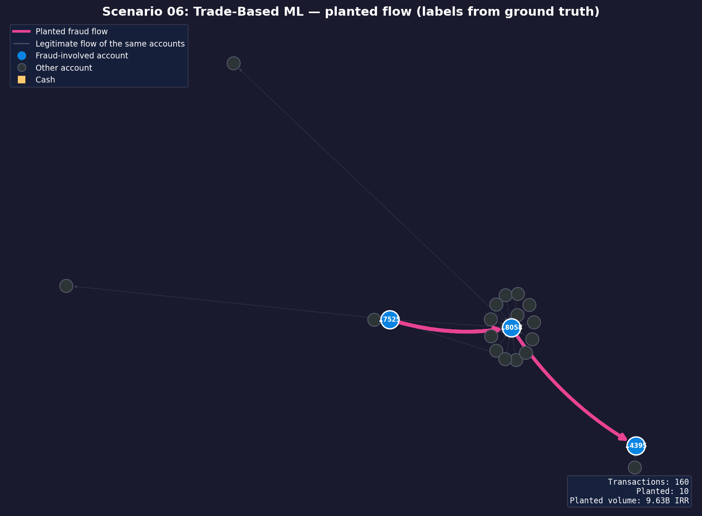

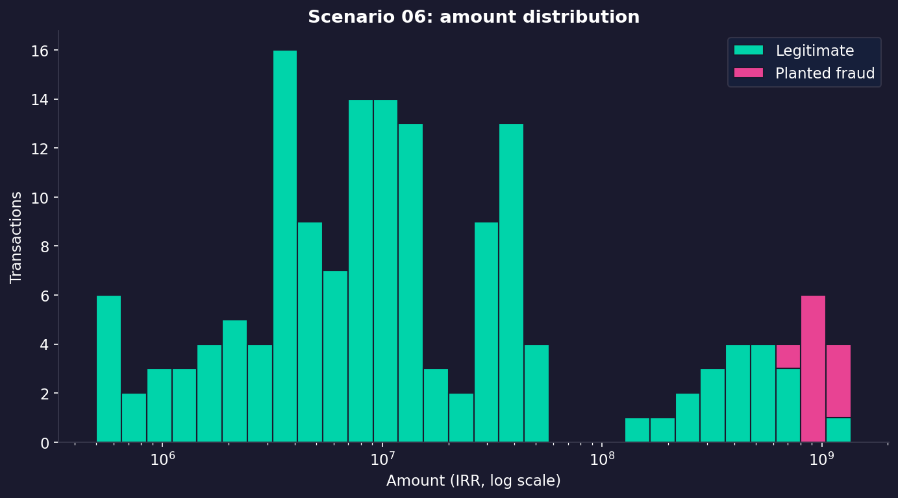


### ۱۱.۵ کوئری تشخیص

```cypher
MATCH p = (imp:Account)-[:SENT]->(t1:Transaction {scenario:'scenario_06'})-[:RECEIVED]->(broker:Account)
          -[:SENT]->(t2:Transaction {scenario:'scenario_06'})-[:RECEIVED]->(exp:Account)
WHERE (exp)<-[:OWNS_ACCOUNT]-(:ForeignNational)
  AND t1.amount >= 500000000
  AND t1.date < t2.date
  AND 0.80 * t1.amount <= t2.amount <= 0.90 * t1.amount
RETURN p
```

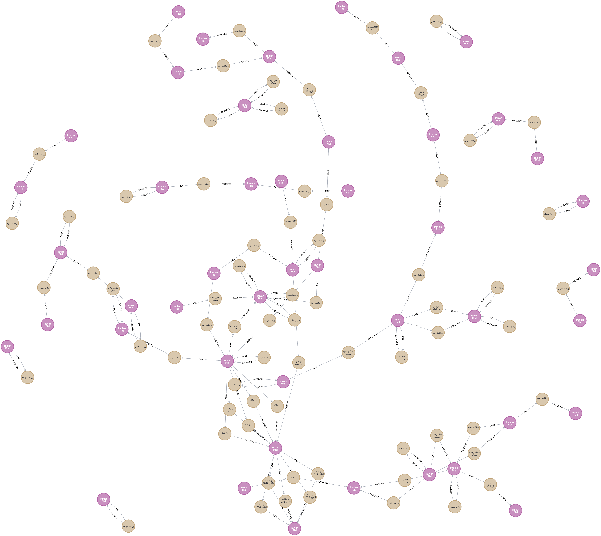

**نتیجه:** کوئری ۱۰ تراکنش برگرداند: ۱۰ مورد کاشته‌شده و ۰ مثبت کاذب. از ۱۰ تراکنش کاشته‌شده، ۱۰ مورد پیدا شد (۱۰۰٪).

---

## ۱۲. سناریوی ۰۷: تقلب کارمند بانک (Insider Fraud)

### ۱۲.۱ شرح سناریو

۶ حساب حقیقی قدیمی (افتتاح پیش از ۱۳۹۸) از یک بانک و یک شعبه، که هیچ فعالیت دیگری ندارند، تقریباً هر ۳ روز یک بار ۵۰ تا ۲۰۰ میلیون ریال را از باجه‌ی شعبه به یکی از ۴ حساب واسط منتقل می‌کنند. حساب واسط ظرف ۱ تا ۲ روز ۸۵ تا ۹۵٪ مبلغ را نقد برداشت می‌کند.

**آمار:**

- الگو: حساب‌های راکد یک شعبه → حساب‌های واسط → نقد
- تعداد تراکنش: ۱۳۲
- تراکنش کاشته‌شده: ۱۲
- تراکنش عادی: ۱۲۰
- حجم تراکنش‌های کاشته‌شده: ۱٬۰۴۴ میلیون ریال
- بازه: ۱ فروردین ۱۴۰۳ تا ۴ اردیبهشت ۱۴۰۳
- نقش‌ها: unauthorized_transfer (۶)، cash_out (۶)

### ۱۲.۲ چطور پنهان شده

- قربانیان جز همین انتقال هیچ تراکنشی ندارند و در نویز دیده نمی‌شوند
- حساب‌های واسط فعالیت عادی دارند

### ۱۲.۳ نشانه‌های تقلب

- حساب راکدی که ناگهان پول می‌فرستد
- همه‌ی قربانیان از یک شعبه‌اند
- گیرنده‌های مشترک
- برداشت نقدی سریع

### ۱۲.۴ نمودارها

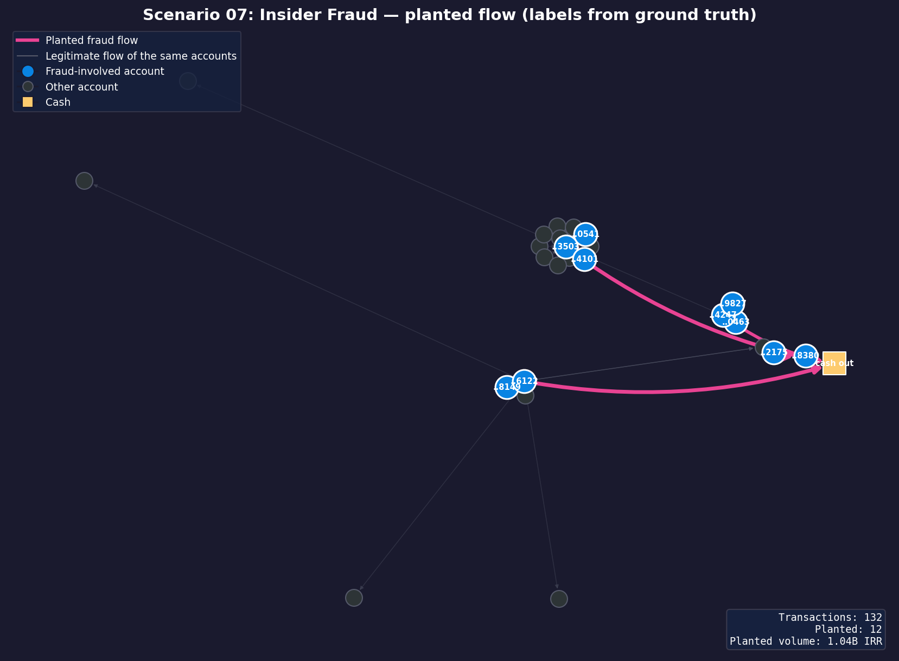

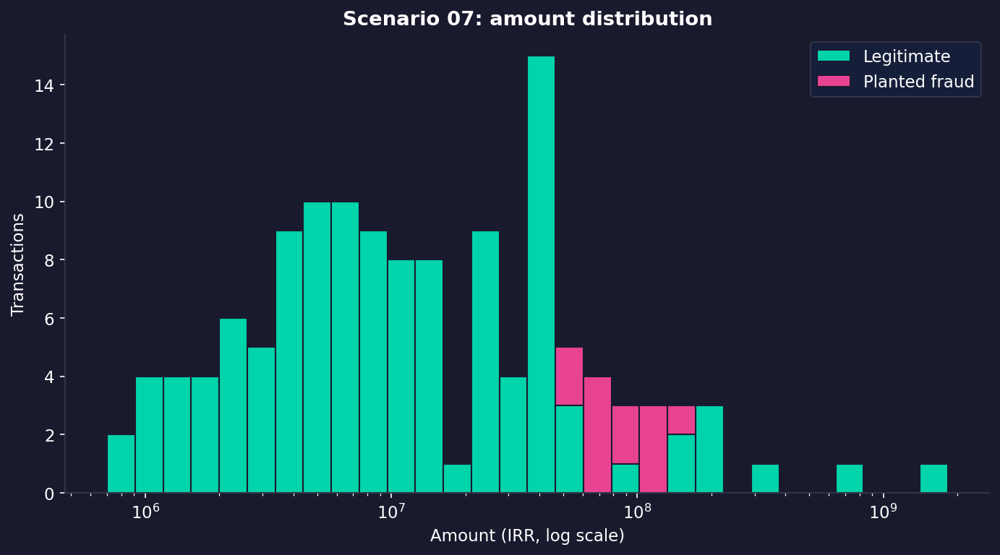

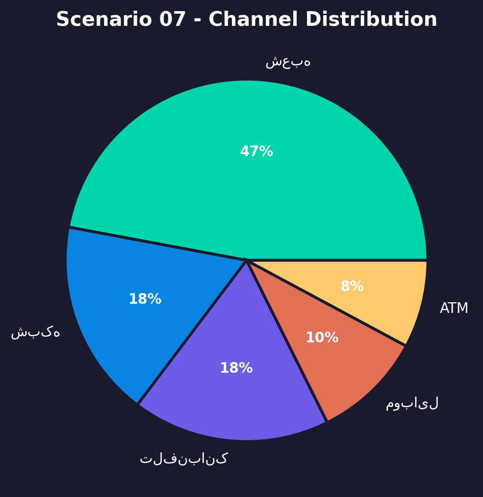

### ۱۲.۵ کوئری تشخیص

```cypher
MATCH p = (v:Account)-[:SENT]->(t:Transaction {scenario:'scenario_07', channel:'شعبه'})-[:RECEIVED]->(m:Account)
WHERE t.amount >= 50000000
  AND NOT EXISTS { (v)-[:SENT]->(o:Transaction {scenario:'scenario_07'}) WHERE o <> t }
  AND NOT EXISTS { (:Transaction {scenario:'scenario_07'})-[:RECEIVED]->(v) }
WITH v.bank_code AS bank, v.branch_code AS branch, collect(p) AS paths
WHERE size(paths) >= 3
UNWIND paths AS p
RETURN p
```

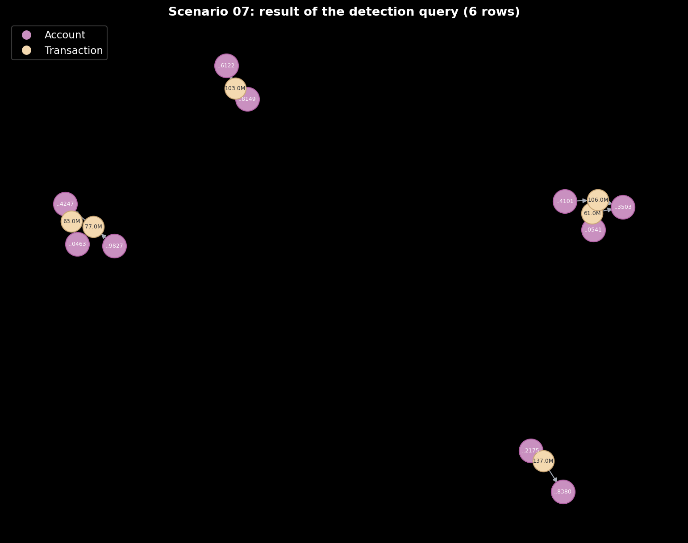

**نتیجه:** کوئری ۶ تراکنش برگرداند: ۶ مورد کاشته‌شده و ۰ مثبت کاذب. از ۱۲ تراکنش کاشته‌شده، ۶ مورد پیدا شد (۵۰٪).

برداشت‌های نقدی حساب‌های واسط (cash_out) گام بعدی‌اند و در خروجی کوئری نیستند.

---

## ۱۳. سناریوی ۰۸: پرداخت‌های دایره‌ای (Circular Payments)

### ۱۳.۱ شرح سناریو

حدود ۱ میلیارد ریال از ۱۸ حساب می‌گذرد و به حساب مبدا برمی‌گردد. بین هر دو گام ۱ تا ۴ روز کاری فاصله است و کل مسیر حدود ۷ هفته طول می‌کشد. در هر گام ۴ تا ۶ درصد کم می‌شود و در پایان حدود ۴۱۶ میلیون به مبدا می‌رسد. سه مسیر فرعی ۲۰۰ میلیونی هم از مبدا جدا می‌شوند و جلوتر به حلقه برمی‌گردند.

**آمار:**

- الگو: حلقه‌ی ۱۸ حسابی تا مبدا + ۳ مسیر فرعی
- تعداد تراکنش: ۲۲۴
- تراکنش کاشته‌شده: ۲۴
- تراکنش عادی: ۲۰۰
- حجم تراکنش‌های کاشته‌شده: ۱۲٬۷۳۰ میلیون ریال
- بازه: ۱ فروردین ۱۴۰۳ تا ۲۴ اردیبهشت ۱۴۰۳
- نقش‌ها: ring_hop (۱۸)، side_path (۶)

### ۱۳.۲ چطور پنهان شده

- شرح‌ها خالی است
- همه‌ی حساب‌های حلقه فعالیت عادی هم دارند

### ۱۳.۳ نشانه‌های تقلب

- چرخه‌ی طولانی که به مبدا برمی‌گردد
- کم شدن یکنواخت مبلغ
- مسیرهای فرعی که دوباره به حلقه می‌پیوندند

### ۱۳.۴ نمودارها

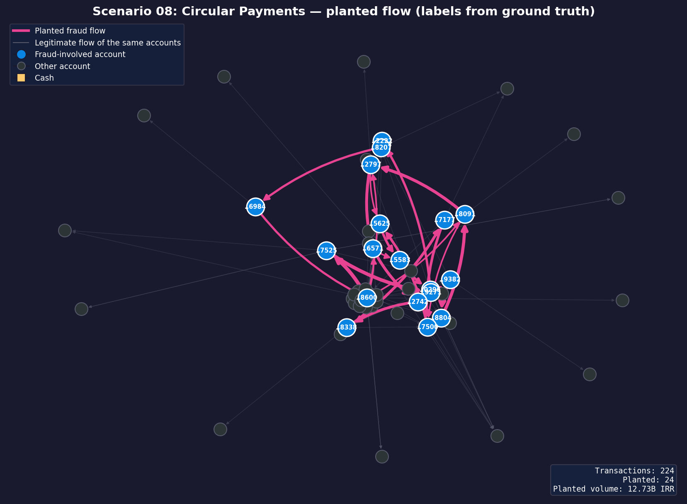

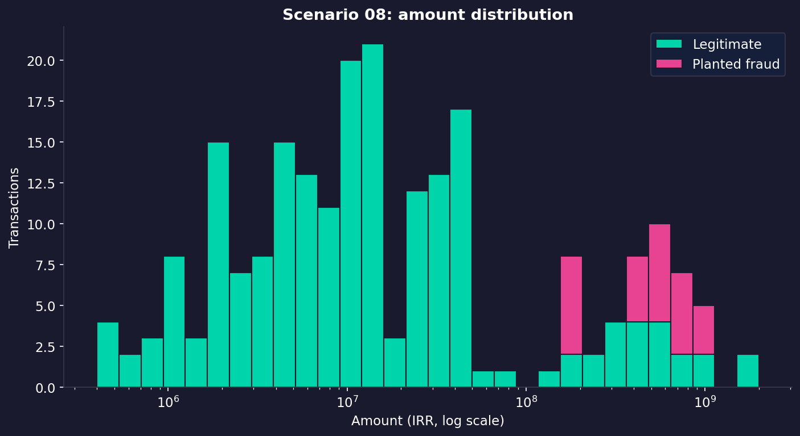

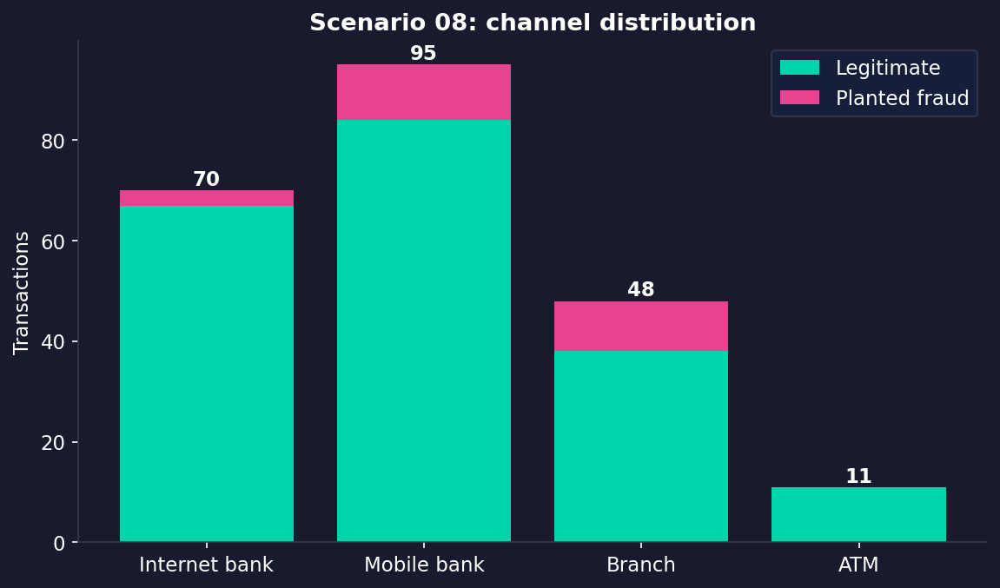

### ۱۳.۵ کوئری تشخیص

```cypher
MATCH p = (a:Account)
          ((:Account)-[:SENT]->(t:Transaction {scenario:'scenario_08'} WHERE t.amount >= 300000000)-[:RECEIVED]->(:Account)){3,20}
          (a)
WHERE all(i IN range(0, size(t) - 2)
          WHERE t[i].date < t[i+1].date AND 0.9 * t[i].amount <= t[i+1].amount <= t[i].amount)
RETURN p
```

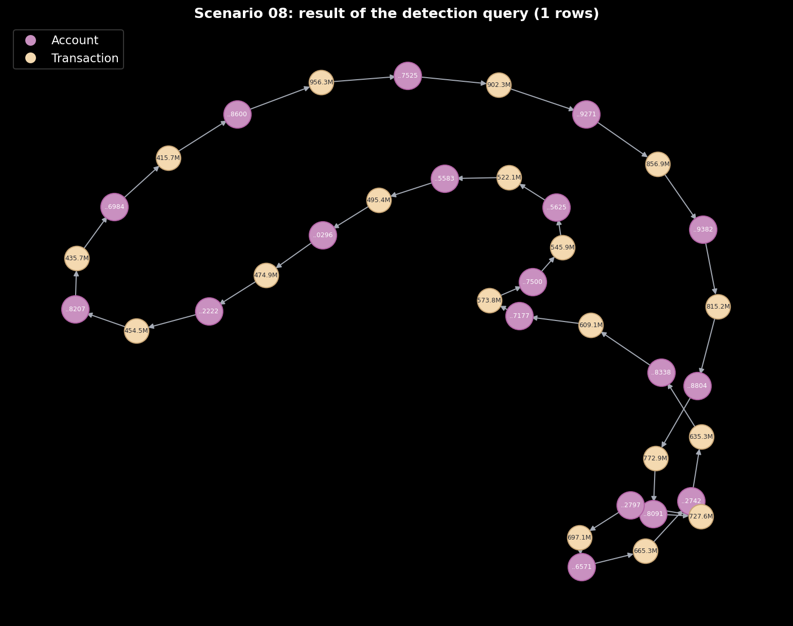

**نتیجه:** کوئری ۱۸ تراکنش برگرداند: ۱۸ مورد کاشته‌شده و ۰ مثبت کاذب. از ۲۴ تراکنش کاشته‌شده، ۱۸ مورد پیدا شد (۷۵٪).

جستجوی چرخه‌ی طولانی بدون محدودیت در Cypher از نظر محاسباتی منفجر می‌شود. این کوئری برای اینکه اجرا شود فقط تراکنش‌های ۳۰۰ میلیون ریال به بالا را بررسی می‌کند و به همین دلیل مسیرهای فرعی ۲۰۰ میلیونی (side_path) را نمی‌بیند.

---

## ۱۴. سناریوی ۰۹: پخش و تجمیع (Scatter-Gather)

### ۱۴.۱ شرح سناریو

یک حساب مبدا در ۳ روز به ۷ حساب حقیقی، هر کدام ۲۸ تا ۵۹ میلیون ریال می‌فرستد. دو تا از این شاخه‌ها از یک حساب واسط دوم هم می‌گذرند. هر شاخه ظرف ۱ تا ۴ روز ۹۵ تا ۹۹٪ پولی را که گرفته به یک حساب جمع‌کننده‌ی مشترک منتقل می‌کند.

**آمار:**

- الگو: یک مبدا → ۷ واسط → یک جمع‌کننده
- تعداد تراکنش: ۱۶۶
- تراکنش کاشته‌شده: ۱۶
- تراکنش عادی: ۱۵۰
- حجم تراکنش‌های کاشته‌شده: ۶۹۰ میلیون ریال
- بازه: ۱ فروردین ۱۴۰۳ تا ۳۰ فروردین ۱۴۰۳
- نقش‌ها: scatter (۷)، relay (۲)، gather (۷)

### ۱۴.۲ چطور پنهان شده

- هر مبلغ در بازه‌ی انتقال‌های شخصی عادی است
- شرح‌ها خالی است
- مبدا، واسط‌ها و جمع‌کننده تراکنش عادی هم دارند

### ۱۴.۳ نشانه‌های تقلب

- پخش پول و جمع شدن دوباره‌ی آن بین همان دو حساب
- عبور تقریباً کامل پول از واسط‌ها
- نگه داشتن کوتاه پول در هر حساب

### ۱۴.۴ نمودارها

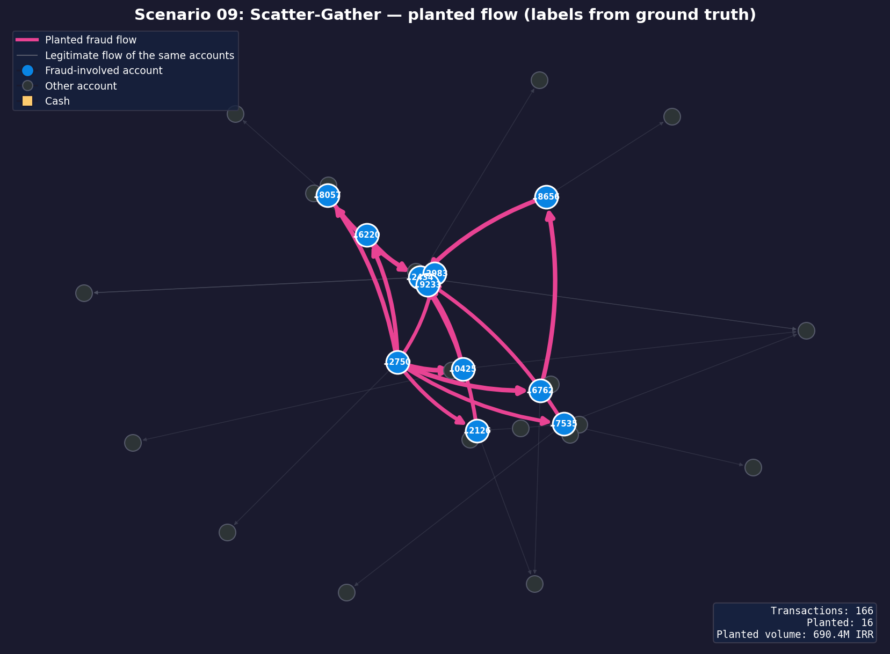

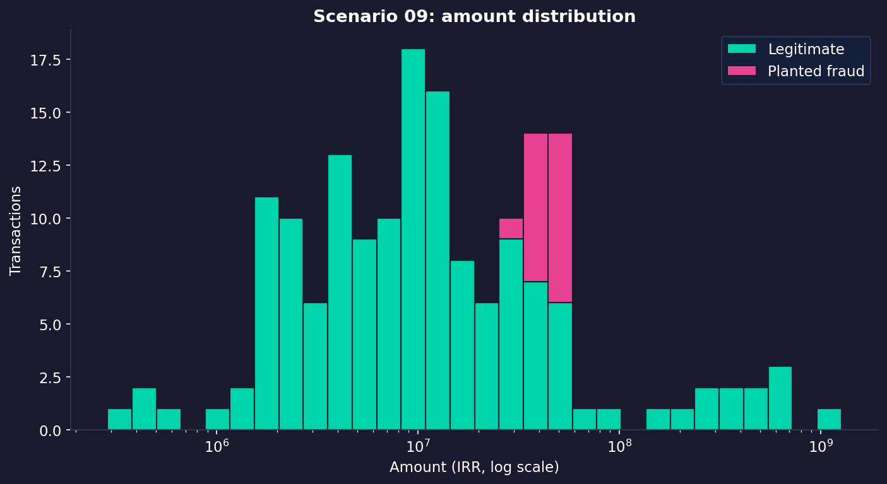

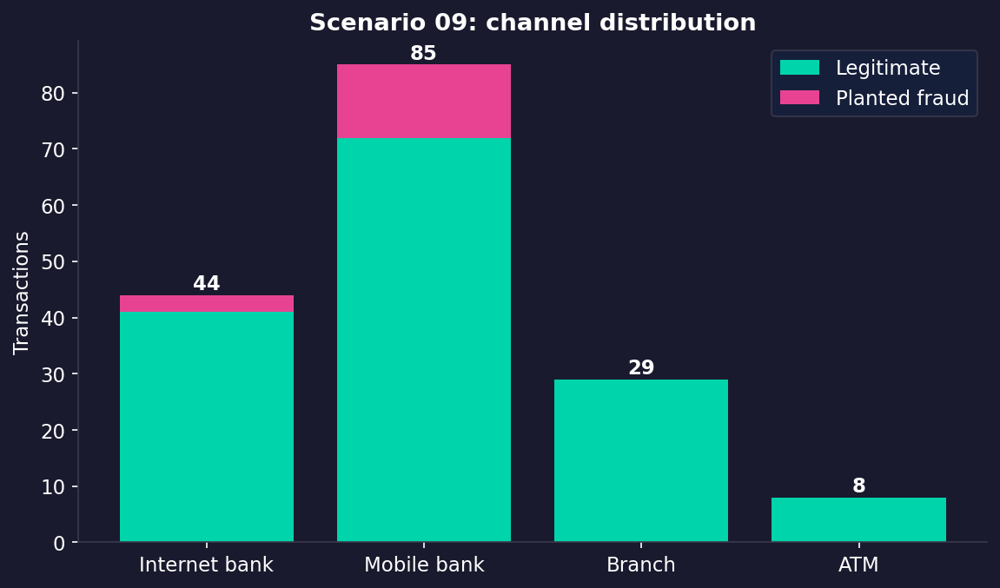

### ۱۴.۵ کوئری تشخیص

```cypher
MATCH p = (s:Account)-[:SENT]->(t1:Transaction {scenario:'scenario_09'})-[:RECEIVED]->(m:Account)
          -[:SENT]->(t2:Transaction {scenario:'scenario_09'})-[:RECEIVED]->(g:Account)
WHERE s <> g AND t1.date < t2.date
  AND 0.8 * t1.amount <= t2.amount <= t1.amount
WITH s, g, collect(p) AS paths, count(DISTINCT m) AS branches
WHERE branches >= 3
UNWIND paths AS p
RETURN p
```

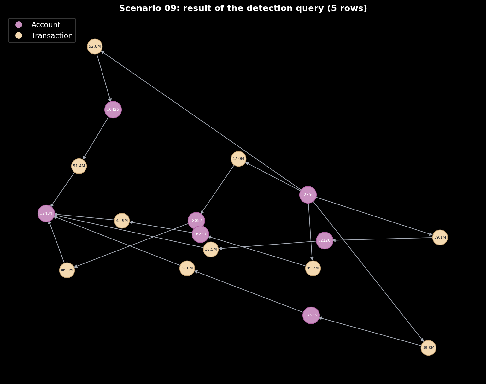

**نتیجه:** کوئری ۱۰ تراکنش برگرداند: ۱۰ مورد کاشته‌شده و ۰ مثبت کاذب. از ۱۶ تراکنش کاشته‌شده، ۱۰ مورد پیدا شد (۶۲٪).

کوئری Cypher فقط شاخه‌های تک‌واسطه را پیدا می‌کند (۵ از ۷). دو شاخه‌ی دوواسطه‌ای را API بخش ۱۶ پیدا می‌کند، چون در آن عمق مسیر ثابت نیست.

---

## ۱۵. نتایج تشخیص

| # | سناریو | برگشتی | درست | مثبت کاذب | کاشته‌شده | پوشش |
|---|---|---|---|---|---|---|
| ۰۱ | لایه‌گذاری ساده | ۱۲ | ۱۲ | ۰ | ۱۵ | ۸۰٪ |
| ۰۲ | خرد کردن تراکنش | ۳۰ | ۳۰ | ۰ | ۳۱ | ۹۷٪ |
| ۰۳ | شبکه‌ی شرکت‌های کاغذی | ۱۲ | ۱۲ | ۰ | ۱۲ | ۱۰۰٪ |
| ۰۴ | تأمین مالی تروریسم | ۱۰۴ | ۱۰۴ | ۰ | ۱۰۴ | ۱۰۰٪ |
| ۰۵ | تصاحب حساب | ۴ | ۴ | ۰ | ۴ | ۱۰۰٪ |
| ۰۶ | پولشویی مبتنی بر تجارت | ۱۰ | ۱۰ | ۰ | ۱۰ | ۱۰۰٪ |
| ۰۷ | تقلب کارمند بانک | ۶ | ۶ | ۰ | ۱۲ | ۵۰٪ |
| ۰۸ | پرداخت‌های دایره‌ای | ۱۸ | ۱۸ | ۰ | ۲۴ | ۷۵٪ |
| ۰۹ | پخش و تجمیع | ۱۰ | ۱۰ | ۰ | ۱۶ | ۶۲٪ |

**محدودیت این سنجش:** کوئری‌ها را با دانستن الگوی هر سناریو نوشته‌ایم و آستانه‌هایشان (نسبت عبور، حداقل مبلغ، تعداد شاخه) را روی همین داده تنظیم کرده‌ایم. پس دقت ۱۰۰٪ یعنی این الگوها با وجود نویز از فعالیت عادی جدا می‌شوند؛ دقت همین کوئری‌ها روی داده‌ای که ندیده‌اند معلوم نیست. هر جا پوشش کمتر از ۱۰۰٪ است، تراکنش‌های جاافتاده گام‌هایی‌اند که بیرون از مسیر برگشتی کوئری قرار دارند.

---

## ۱۶. سرویس تحلیل مسیر

سرویسی که با FastAPI روی Neo4j ساخته شده، به دو پرسش جواب می‌دهد. جستجو روی کل گراف انجام می‌شود و مسیرها ترتیب زمانی دارند: هر گام فقط وقتی حساب می‌شود که پول پیش از آن به حساب رسیده باشد.

### ۱۶.۱ نقش یک شبا در الگوی پخش و تجمیع

مسیر: `GET /shebas/{sheba}/scatter-gather`

این سرویس مشخص می‌کند یک شبا در الگوی پخش و تجمیع پول بوده یا نه، و اگر بوده نقشش مبدا بوده، مقصد یا واسط. برای هر الگو همه‌ی شاخه‌ها با جزئیات تراکنش‌ها برمی‌گردد، همراه با مبلغ پخش‌شده و جمع‌شده، درصدی که در راه کم شده و مدت الگو. مبدا می‌تواند یک حساب باشد یا واریزهای نقدی. پارامترهای قابل تنظیم و مقدار پیش‌فرضشان: حداقل تعداد شاخه (۲)، حداکثر واسط در هر شاخه (۳)، بازه‌ی زمانی (۳۰ روز) و حداقل سهمی که هر حساب باید جلو بفرستد (۰٫۸).

### ۱۶.۲ رابطه‌ی بین شباها

مسیر: `POST /relationships`

فهرستی از شباها می‌گیرد و برای هر جفت بررسی می‌کند که در هر کدام از دو جهت، با هر تعداد واسطه، مسیر انتقال پول هست یا نه. کوتاه‌ترین مسیر با جزئیات تراکنش‌ها برمی‌گردد و اگر دو حساب مالک مشترک داشته باشند، آن هم گزارش می‌شود.

### ۱۶.۳ نتیجه روی داده

- در سناریوی ۰۹ هر ۷ شاخه و هر ۱۶ تراکنش کاشته‌شده پیدا شد و نقش مبدا، مقصد و واسط درست تشخیص داده شد
- سناریوی ۰۲ به شکل الگویی با مبدا نقدی و ۹ شاخه پیدا شد و هر ۱۸ تراکنش مربوط در آن بود
- در کل گراف فقط ۵ الگوی پخش و تجمیع وجود دارد: دو الگوی کاشته‌شده (۹ و ۷ شاخه) و سه الگوی کوچک ۲ تا ۳ شاخه‌ای که بیشترشان نویزند
- حدود ۷۵٪ جفت‌حساب‌ها مسیر زمانیِ معتبری به هم دارند. به همین دلیل جواب «رابطه دارد» به‌تنهایی چیز زیادی نمی‌گوید و باید خود مسیر را دید: تعداد گام‌ها، تاریخ‌ها و مبالغ

---

## ۱۷. محدودیت‌ها

- اطلاعات تماس مشترک مثل تلفن، نشانی یا IP مدل نشده، چون قالب ۳۰ ستونی FATF چنین فیلدی ندارد
- مبالغ در همان مقیاس اولیه‌ی پروژه مانده‌اند (سقف گزارش‌دهی ۵۰ میلیون ریال) و با سطح ریالی سال ۱۴۰۳ تطبیق داده نشده‌اند
- همه‌ی سناریوها در یک بازه‌ی زمانی و روی یک مجموعه حساب مشترک ساخته شده‌اند، پس در جستجوی کل گراف ممکن است مسیرها از نویز سناریوهای دیگر بگذرند
- سرویس تحلیل مسیر در هر درخواست همه‌ی تراکنش‌ها را در حافظه می‌خواند. این روش برای حجم فعلی کار می‌کند ولی برای میلیون‌ها تراکنش باید عوض شود
- تصاویر «خروجی کوئری» از نتیجه‌ی واقعی کوئری‌ها روی Neo4j رسم شده‌اند و اسکرین‌شات Neo4j Browser نیستند

---

## ۱۸. جمع‌بندی

ساختار گرافی هر الگو (زنجیره، چرخه، هم‌گرایی، پخش و تجمیع) همراه با ترتیب زمانی تراکنش‌ها کافی بود تا الگوها با وجود مبالغ هم‌پوشان و شرح‌های خنثی از نویز جدا شوند. برای الگوهایی که عمقشان ثابت است کوئری Cypher کافی است. وقتی عمق مسیر متغیر است و ترتیب زمانی مهم است، جستجوی مسیر در سرویس API بهتر جواب می‌دهد.

---

## منابع

- [FATF 40 Recommendations](https://www.fatf-gafi.org/publications/fatf-standards/)
- [FATF Typologies Reports](https://www.fatf-gafi.org/publications/typologies/)
- [Central Bank of Iran](https://www.cbi.ir/)
- [Sheba / IBAN structure: Iran](https://www.ibantest.com/en/iban-structure/iran)

</div>
